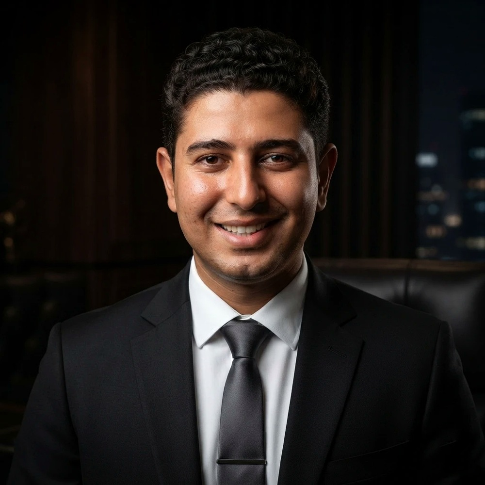

# Mina Maged Zekry Gayid

**Applied AI Intern · Dentist · Healthcare MBA Candidate** 
Aswan, Egypt

---

## 👋 About

I am an **Applied AI Intern at FlyRank AI**, a dentist, owner of Happy Dental Clinic, and MBA candidate in Hospital and Healthcare Facilities Administration. My work sits at the intersection of **healthcare, business operations, data, and practical AI**.

I enjoy turning ambiguous problems into clear, reviewable workflows. My current focus includes Claude and Claude API fundamentals, prompt engineering, AI workflow design, structured research and file workflows, output evaluation, and responsible AI use with human review in the loop.

## 🧭 Current focus

- Building practical AI fluency through FlyRank AI and Anthropic Academy coursework
- Exploring AI-assisted workflows for research, content, organic growth, and repeatable business processes
- Connecting clinical and healthcare-operations context with data-informed problem solving
- Open to internships and projects in applied AI, AI operations, healthcare technology, and data-focused work

## 💼 Experience

- **FlyRank AI** — *Applied AI Intern* (Jun 2026 – present) 
  Apply Claude and prompt-engineering techniques to structured research, file-based tasks, and practical business workflows. Evaluate outputs for relevance, limitations, and responsible use.
- **Happy Dental Clinic** — *Owner & Dentist* (Aug 2023 – present) 
  Own and operate a patient-centered dental clinic while managing clinical care, scheduling, patient communication, supplies, records, and service delivery.
- **Egypt Healthcare Authority** — *Dentist, El Gozayra Family Medicine Unit* (Aug 2022 – Aug 2024) 
  Delivered patient-centered dental care in a public primary-care setting and coordinated with multidisciplinary healthcare teams.

## 🧪 Selected AI work

### Applied AI and Claude Workflow Portfolio

Hands-on work completed through the FlyRank AI internship and Anthropic Academy, focused on:

- Claude and Claude API fundamentals
- Prompt engineering and reusable prompt-driven workflows
- Research and file-based workflows
- Output evaluation, model capabilities, and limitations
- Responsible AI review and human-in-the-loop decision points

**Outcome:** completed seven Anthropic Academy credentials, including *Building with the Claude API*, *AI Fluency for Builders*, *Claude 101*, *AI Capabilities and Limitations*, and *Introduction to Claude Cowork*.

## 🎓 Education

- **Arab Academy for Science, Technology & Maritime Transport** — *MBA, Hospital and Healthcare Facilities Administration/Management* (Apr 2025 – Mar 2027 expected)
- **Modern Sciences and Arts University** — *Bachelor of Dentistry (BDS)* (2015 – 2020) 
  GPA **3.72** · **Highest Honors**

## 🧠 Skills

**Applied AI** 
Claude · Claude API fundamentals · Prompt engineering · Generative AI · AI workflow design · Output evaluation · Responsible AI · Foundational ML concepts

**Programming & data** 
Python · SQL · Power BI · Tableau · Excel · HTML · CSS · JavaScript

**Healthcare & business** 
Clinical dentistry · Healthcare management · Hospital administration · Clinic operations · Project management · Research

**Productivity & cloud foundations** 
Microsoft Word · PowerPoint · Teams · AWS · Azure

**Languages** 
Arabic (native) · English (C1)

## 📫 Connect

- 🌐 **Portfolio:** [minagayid.github.io](https://minagayid.github.io)
- 💼 **LinkedIn:** [mina-maged-zekry-gayid](https://www.linkedin.com/in/mina-maged-zekry-gayid/)
- 📧 **Email:** [minagayid@gmail.com](mailto:minagayid@gmail.com)

Healthcare context, practical AI, and thoughtful execution.

